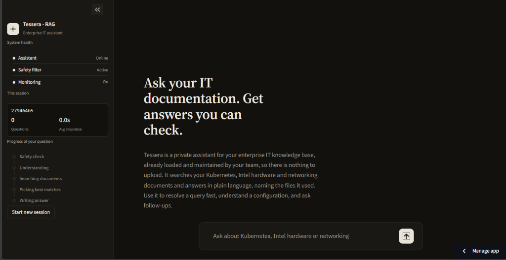
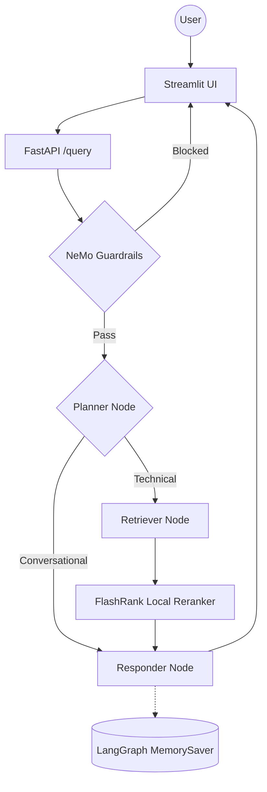

# Tessera-RAG System

[](https://tessera.streamlit.app/)

> **Live Application**: [https://tessera.streamlit.app/](https://tessera.streamlit.app/)



A production-grade, enterprise-level Agentic RAG system built with **LangGraph**, **Portkey LLM Gateway**, and **Gemini Embeddings**. The system distinguishes between technical "True Data" and random "Noisy Data" using semantic re-ranking, history-aware planning, and NeMo Guardrails for input and output safety.

---

## Key Features

- **Agentic Intelligence**: LangGraph state graph for cyclic reasoning, multi-step planning, and conversational memory (`MemorySaver`).
- **Guardrails Gate**: NeMo Guardrails layer blocks off-topic requests, general programming queries, and jailbreak attempts before any vector search.
- **LLM Gateway**: Portkey routes all inference calls with semantic caching, automatic fallback between keys, and retry policies.
- **Enterprise Search**: Hosted Qdrant Cloud vector search paired with FlashRank for local, zero-latency cross-encoder re-ranking.
- **High-Dimension Embeddings**: Google `gemini-embedding-2-preview` (3072-dim) with adaptive exponential backoff for rate limits.
- **Universal Document Parsing**: Idempotent on-device extraction for PDF, HTML, TXT, DOCX, and PPTX with duplicate skipping.
- **Distributed Observability**: Full trace nesting with **Pydantic Logfire** and **LangSmith** across all agent execution spans.
- **Evaluation Suite**: Automated RAGAS evaluation pipeline covering 6 metrics with a dedicated Streamlit dashboard.

---

## Agent Intelligence Flow



---

## Project Structure

```text
├── app/
│   ├── agents/
│   │   ├── nodes/       # Planner, Retriever, Responder LangGraph nodes
│   │   ├── graph.py     # StateGraph definition and checkpoint compilation
│   │   └── state.py     # AgentState TypedDict schema
│   ├── gateway/         # Portkey LLM gateway client, slugs, and fallback routing
│   ├── guardrails/      # NeMo Guardrails Colang rules, indicators, and runtime
│   ├── ingestion/
│   │   ├── chunking/    # Paragraph-based text splitter
│   │   ├── loaders/     # Local parsers: PDF, Office (DOCX, PPTX), HTML, TXT
│   │   └── processor.py # Universal ingestion engine with idempotent skipping
│   ├── services/
│   │   └── retrieval/   # Gemini embeddings, Qdrant client, and FlashRank reranking
│   ├── config.py        # Centralized settings and environment management
│   └── main.py          # FastAPI application entrypoint with /query and /graph
├── evals/               # RAGAS evaluation suite, golden dataset, and Streamlit app
├── ui/                  # Streamlit chat interface with thought-process transparency
├── processed_data/      # Parsed and chunked JSON metadata per document
├── docs/                # Architecture, design decisions, and operational guides (11 docs)
├── DATA/                # Datasets: ground truth (true_data) and distractor (noisy_data)
├── Dockerfile           # Multi-stage production container configuration
└── requirements.txt     # Pinned Python dependencies
```

---

## Tech Stack

| Layer | Technology |
| :--- | :--- |
| Orchestration | LangChain + LangGraph |
| LLMs | Groq via **Portkey** Gateway (`openai/gpt-oss-120b`, `llama-3.3-70b`) |
| Guardrails | NVIDIA NeMo Guardrails (Colang) |
| Vector Database | Qdrant Cloud |
| Re-ranking | FlashRank (`ms-marco-TinyBERT-L-2-v2`, local CPU) |
| Embeddings | Google `gemini-embedding-2-preview` (3072 dimensions) |
| Document Parsing | Local loaders (pypdf, python-docx, python-pptx, BeautifulSoup) |
| Observability | Pydantic Logfire + LangSmith |
| Evaluation | RAGAS + custom Tool Correctness (Jaccard) |

---

## Getting Started

### 1. Install Dependencies

```powershell
python -m venv .venv
.\.venv\Scripts\activate
pip install -r requirements.txt
```

### 2. Configure Environment

Create a `.env` file in the project root with the following variables:

```ini
# LLM Inference (Groq & Portkey Gateway)
GROQ_API_KEY=""
GROQ_FALLBACK_API_KEY=""
GROQ_SLUG="rag2"
GROQ_MODEL="openai/gpt-oss-120b"
PORTKEY_API_KEY=""

# Vector Database (Qdrant Cloud)
QDRANT_API_KEY=""
QDRANT_URL=""
QDRANT_COLLECTION="enterprise-knowledge-base"

# Embeddings (Google Gemini)
GEMINI_API_KEY=""

# Observability
LOGFIRE_TOKEN=""
LANGSMITH_TRACING=true
LANGSMITH_ENDPOINT="https://api.smith.langchain.com"
LANGSMITH_API_KEY=""
LANGSMITH_PROJECT="tessera-rag"

# Service URLs
BACKEND_URL="http://localhost:8000"

# Evaluation Judge LLM
JUDGE_GROQ=""
```

### 3. Run Data Ingestion

Scans documents in `DATA/`, extracts text locally, chunks paragraphs, saves metadata to `processed_data/`, and indexes vectors into Qdrant. The ingestion process is idempotent and automatically skips already-indexed files.

```powershell
# Ingest entire DATA directory (skips already-indexed files automatically)
python -m app.ingestion.processor DATA

# Drop and recreate collection from scratch
python -m app.ingestion.processor DATA --wipe

# Ingest a specific directory
python -m app.ingestion.processor DATA/true_data true
```

### 4. Launch the Applications

```powershell
# Terminal 1: FastAPI Backend
uvicorn app.main:app --reload --port 8000

# Terminal 2: Streamlit Chat Interface
streamlit run ui/app.py
```

- Web Chat UI: `http://localhost:8501`
- Swagger Documentation: `http://localhost:8000/docs`
- Interactive Agent Graph: `http://localhost:8000/graph`

### 5. Run the Evaluation Suite (Optional)

```powershell
# Requires the backend running on port 8000
streamlit run evals/app.py
```

---

## API Reference

### POST `/query`

Executes the agentic pipeline with Gate 1 NeMo Guardrails check and Gate 2 LangGraph multi-step reasoning.

#### Request

```json
{
  "q": "What is the recommended approach for autoscaling pods based on custom metrics?",
  "thread_id": "default_user"
}
```

#### Response (Clean Technical Query)

```json
{
  "question": "What is the recommended approach for autoscaling pods based on custom metrics?",
  "answer": "To autoscale pods using custom metrics, deploy the Horizontal Pod Autoscaler (HPA) configured against the Custom Metrics API paired with the Prometheus Adapter...",
  "thought_process": [
    "Start",
    "Intent: Technical",
    "Search Term: Kubernetes pod autoscaling custom metrics HPA Prometheus adapter",
    "Response generated."
  ],
  "status": "Response generated.",
  "sources": [
    "pods_autoscale.html",
    "architecture.pptx"
  ]
}
```

#### Response (Out-of-Scope Query Blocked by Guardrail)

```json
{
  "question": "write a code to reverse a string in cpp",
  "answer": "I'm an Enterprise IT Assistant focused on Kubernetes, Intel hardware, and networking documentation. I cannot assist with general programming tasks or unrelated topics.",
  "thought_process": [
    "Intent: Guardrails Fired",
    "Retrieval: Skipped"
  ],
  "status": "Blocked by guardrails.",
  "sources": []
}
```

---

## Documentation Index

| # | Guide | What It Covers |
| :--- | :--- | :--- |
| 01 | [System Overview](docs/01_SYSTEM_OVERVIEW.md) | High-level vision and end-to-end request lifecycle |
| 02 | [Ingestion Engine](docs/02_INGESTION_ENGINE.md) | Document parsing, paragraph chunking, and indexing |
| 03 | [Node Intelligence](docs/03_NODE_INTELLIGENCE.md) | Planner, Retriever, and Responder internals |
| 04 | [Observability](docs/04_TRACING_AND_OBSERVABILITY.md) | Logfire and LangSmith distributed tracing |
| 05 | [Environment Variables](docs/05_ENVIRONMENT_VARIABLES.md) | Environment configuration reference |
| 06 | [Known Gotchas](docs/06_KNOWN_GOTCHAS.md) | Non-obvious bugs, rate limits, and architectural decisions |
| 07 | [FlashRank Reranking](docs/07_FLASHRANK_RERANKING.md) | Local cross-encoder semantic re-ranking |
| 08 | [Guardrails](docs/08_GUARDRAILS.md) | NeMo Guardrails implementation and Colang flows |
| 09 | [LLM Gateway](docs/09_LLM_GATEWAY.md) | Portkey routing, fallback, and semantic caching |
| 10 | [Evaluation Theory](docs/10_EVALS.md) | RAGAS metrics formulation and token budgeting |
| 11 | [Evaluation Pipeline](docs/11_EVALS_PIPELINE.md) | Live evaluation pipeline and Streamlit dashboard |

---

*Built for High-Scale Enterprise Document Intelligence.*
